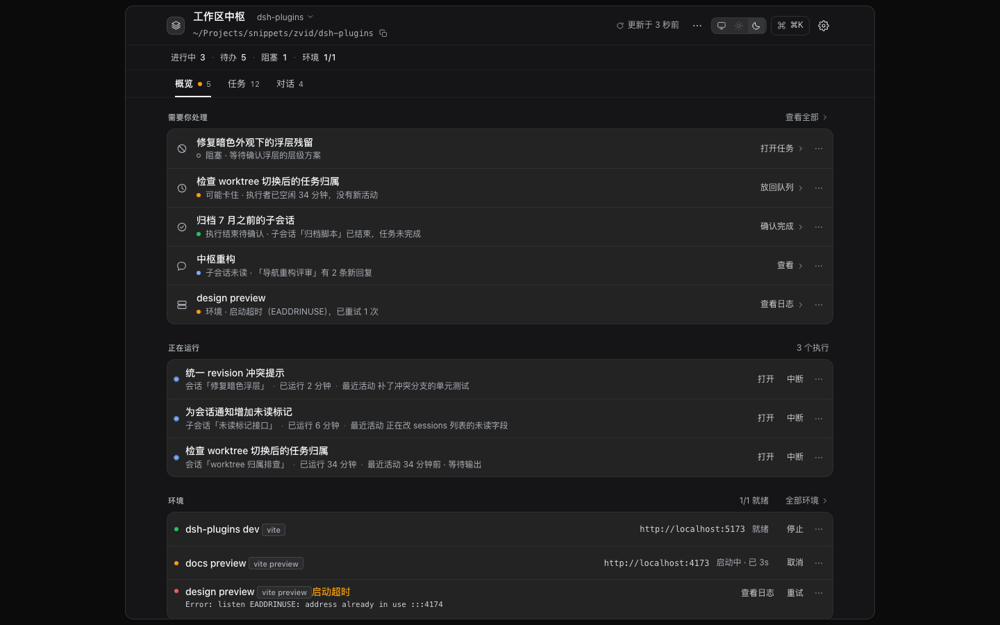
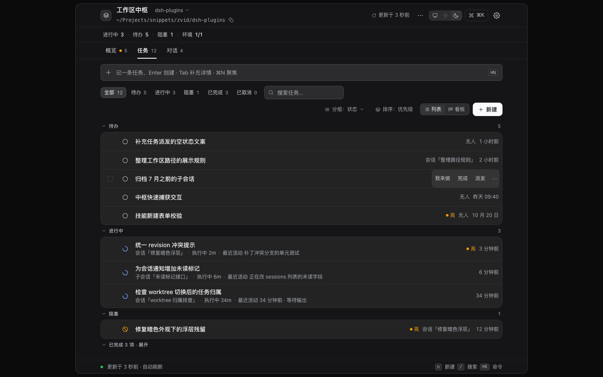
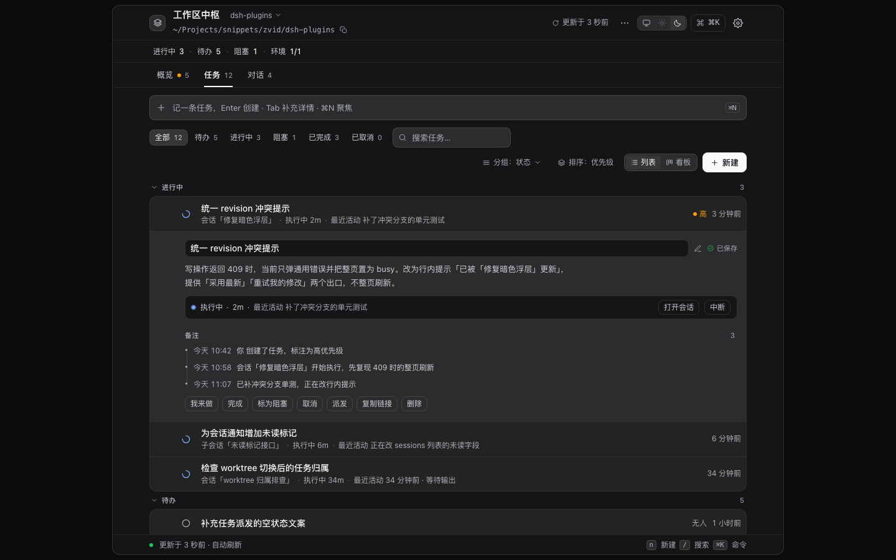
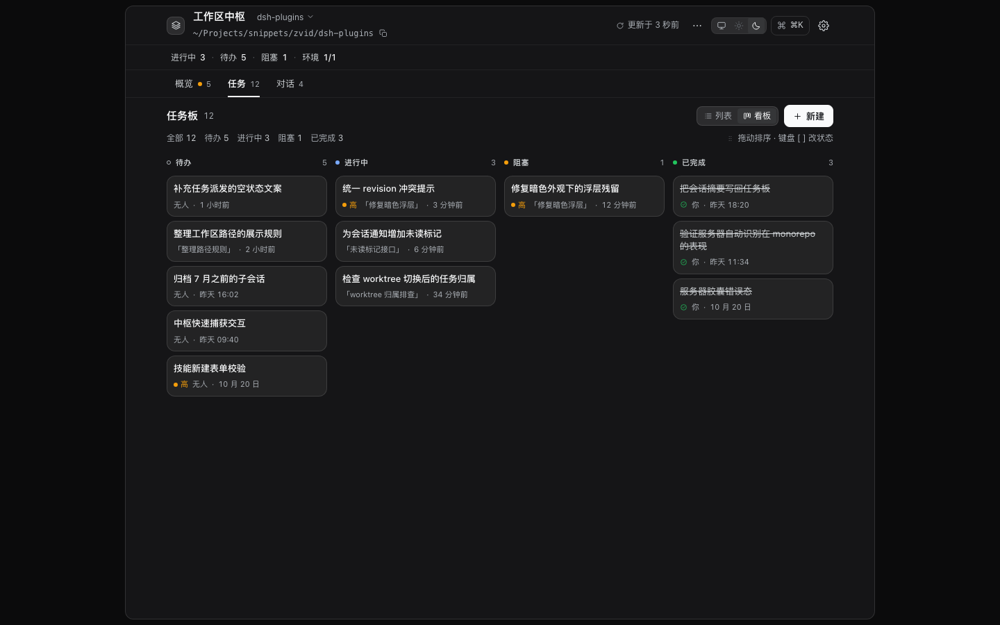
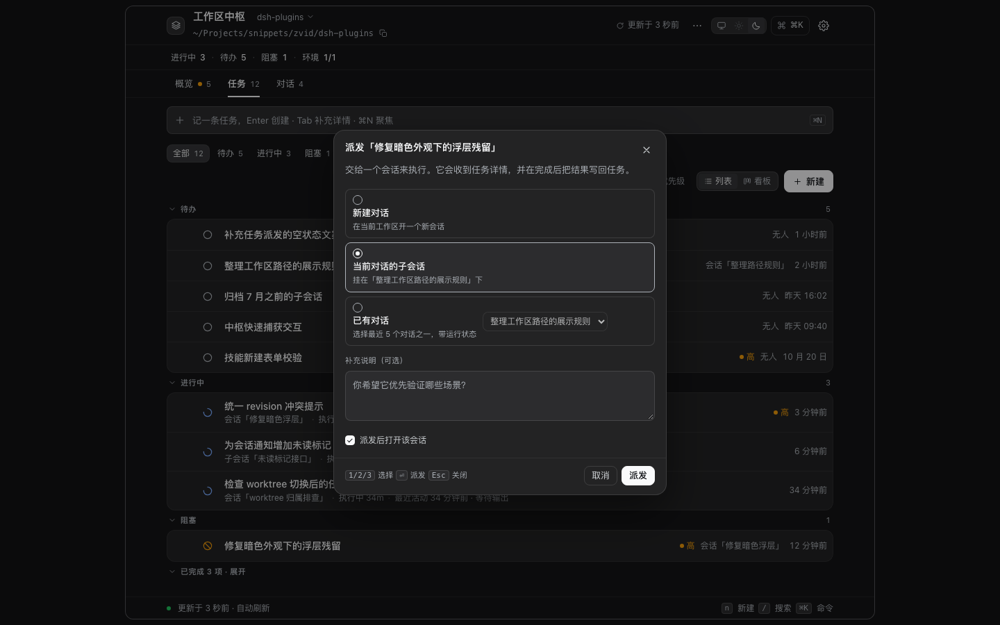
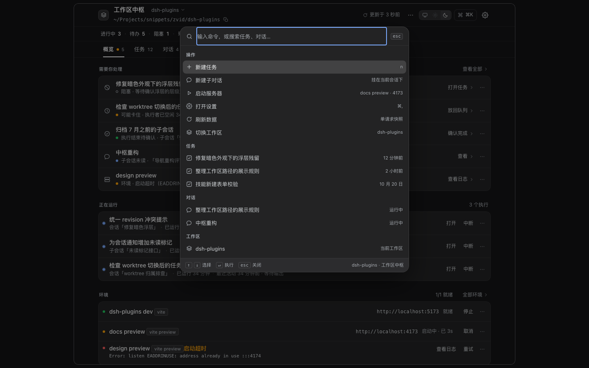
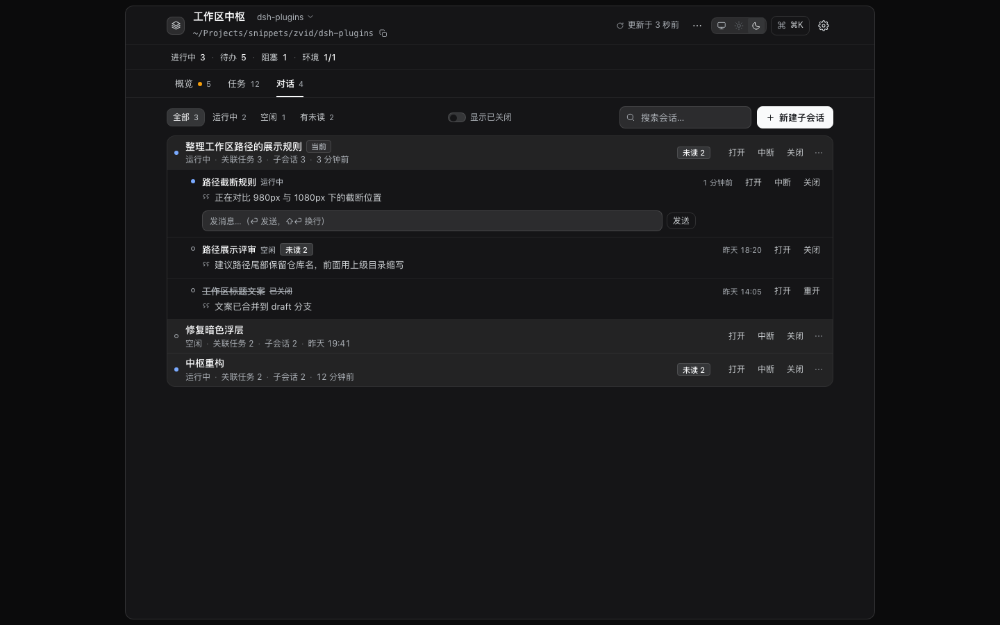
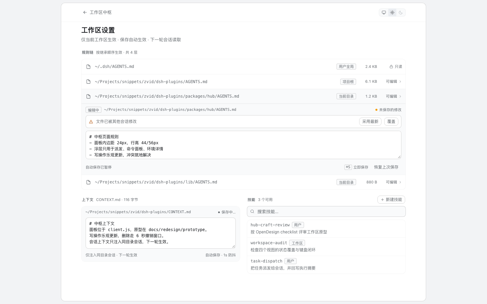
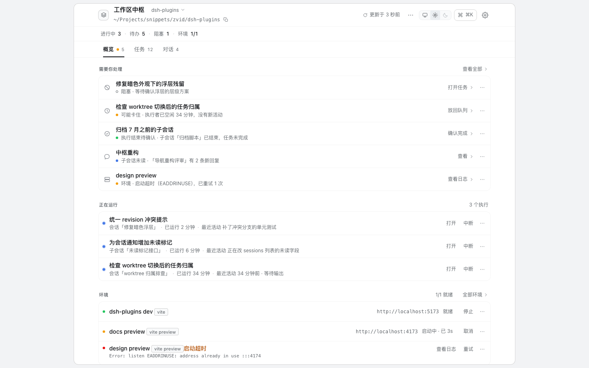
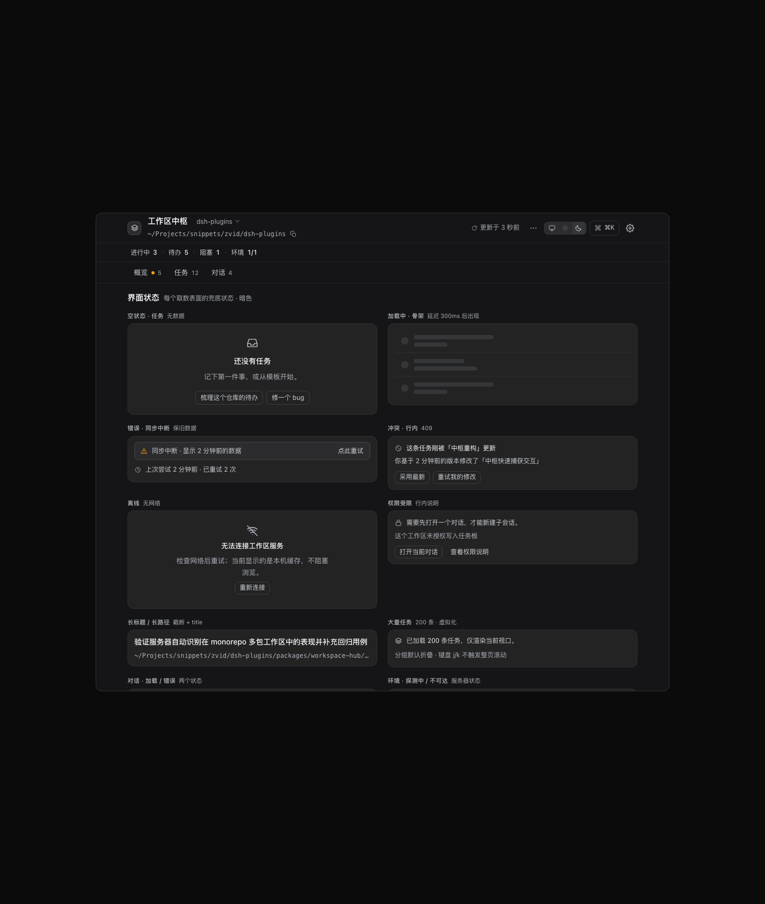

# 工作区中枢 · 交互逻辑与 UI 重构提案

> 面向 DeepSeek Harness 插件 **Workspace Hub / 工作区中枢** 的一次完整 redesign：从「四个标签页 + 四张 CRUD 列表」改造成「工作区工作台（Console）」。  
> 交付：现状审计 · 设计策略 · 高保真可交互原型 · OpenDesign 工具链与评审基线 · 实施路线。
>
> **更新（2026-10-22）**：中枢已按后续决定升级为**顶层全局场所**（侧边栏入口 + 所有工作区首页 + 工作区 drill-in）。入口/导航模型以 [`05-global-hub.md`](05-global-hub.md) 为准；本文其余部分描述 Console 内部交互与视觉。  
> 日期：2026-10-22 · 参照代码：`client.js` 2232 行 / `lib/*.js`

---

## 1. 一句话

现在的中枢把数据放全了，却没有回答用户最常问的那句话——**「这个工作区现在怎么样，我该做什么？」** 任务、执行它的会话、子会话回复、开发服务器在界面里互不相认，用户只能靠 `session-xxxx` 自己拼；打开面板后还要 5–8 次点击才能看清现状。

这次重构做三件事：**按「注意力」重排信息架构、把任务与执行者显式连起来、把所有高频操作就地完成**。视觉上回到 DSH 宿主自己的语言（石墨表面 / 发丝线 / 单一主色 / 等宽元数据），不再模仿 macOS。

---

## 2. 现状：三个结构性根因（实测）

| # | 根因 | 证据 |
|---|---|---|
| 1 | **信息架构按数据类型切，不按用户意图切**：任务 / 会话 / 服务器 / 工作区四个 tab 是四张表，关系不可见 | 一次巡检需 7 次点击，其中 2 次离开中枢（`01-current-audit.md` §10a） |
| 2 | **提交-等待-整页刷新**：任一写操作锁全页，成功后串行重取 3 个请求；无乐观更新、无撤销、冲突只有通用报错 | `client.js:1292-1303`；面板打开 **≈85 请求/分**（5 条定时器） |
| 3 | **中枢是「要去的地方」，不是「会叫你的地方」**：入口无注意力信号；筛选/展开/滚动关闭即丢；常驻 5 步引导卡 | `client.js:1968-1982, 2020-2023, 2110` |

另有 5 个后端能力**零 UI 入口**：子会话 `send / interrupt / reopen`、`includeClosed`、任务备注与 `dispatch` 状态；`notes / dispatch / lastAssistantMessage` 已返回但被丢弃。子会话关闭后在所有界面消失、无法找回。

---

## 3. 方案：工作区工作台（Graphite Console）

### 3.1 一个对象模型，取代四张表

```
Workspace ─┬─ WorkItem 任务 ⇄ Run 一次执行（主会话 / 子会话）
           ├─ Session 对话（主 / 子，运行 / 空闲 / 关闭，未读）
           ├─ Environment 开发服务器（启动中 / 就绪 / 超时 / 崩溃 / 外部 / 停止）
           └─ Contract 规则链 / 上下文 / 技能
```

任务行上永远能看到「执行者 + 已运行时长 + 最近活动」；展开即是运行条与打开会话入口。`revision`、`session-id` 从界面消失，冲突在行内解决。

### 3.2 新的信息架构

```
头部：工作区（可切换）· 路径（可复制）· 同步状态 · ⌘K · ⚙
状态条：进行中 3 · 待办 5 · 阻塞 1 · 环境 1/1
导航：概览 | 任务 12 | 对话 4
内容：概览 = 需要你处理 → 正在运行 → 环境
      任务 = 快速捕获 → 筛选/分组 → 列表 / 看板
      对话 = 会话树 + 子会话行内回复
设置 = ⚙ 进入的次级视图（规则链 / 上下文 / 技能）
浮层 = 命令面板 ⌘K · 派发 sheet · 环境 popover · 撤销 toast
```

- **服务器不再是 tab**：改成常驻状态条 + 概览里的环境区 + 胶囊 popover。它本质是状态，不是列表；条件出现的第四 tab 会让不同工作区的导航结构不一致。
- **设置降级为 ⚙**：低频、易错，不该与高频操作平级；带自动保存、⌘S、文件冲突三选一。
- **概览作为首页**：注意力队列优先（阻塞 / 可能卡住 / 执行结束待确认 / 未读 / 环境异常），每条给一个主操作，最多 5 条。

### 3.3 关键流程：Before → After

| 流程 | 现在 | 重构后 |
|---|---|---|
| 看清现状 | 7 次点击、跨 3 个 tab、2 次离开中枢 | **1 屏**：注意力 + 运行中 + 环境 |
| 新建并派发 | 8 次点击 + 等待两次刷新、只回 `session-xxxx` | **已有任务时 3 步**（`d` → 选目标 → `↵`）；从零创建再派发目前 5 步，P2 补「创建并派发」一体化 composer |
| 跟踪已派发任务 | 任务页看不到进展，去会话页再打开会话 | 任务行常驻执行者 + 最近活动；展开看运行条与打开会话入口 |
| 给子会话补话 / 中断 | 必须离开中枢进入子会话（4 次点击） | 会话页子会话行**内联回复 + 中断/重开**，关闭可找回（原型已演示） |
| 起服务器 | 20–30s 阻塞白等、不能取消、不自动打开 | 异步启动 + 进度 + 取消 + 就绪打开；失败给日志（Host 依赖，原型只演示状态机） |
| 误删 | 原生 confirm，不可撤销 | 软删除 + 6s 撤销 toast（需 Host 端点；原型演示前端交互） |
| 改规则 | 保存按钮永远可点、覆盖无提示 | 脏状态 + 自动保存 + ⌘S + 冲突「采用最新/覆盖 / 另存」（文件 CAS 为 Host 依赖） |

---

## 4. 界面

### 概览（默认首页，暗色）
注意力队列 → 正在运行 → 环境，一屏回答「现在怎么样」。



### 任务（列表 / 展开 / 看板）
快速捕获、分组、行内编辑、运行条、批量选择。







### 派发 sheet 与命令面板
派发只保留一个多步浮层；⌘K 覆盖全部主操作。





### 对话（含子会话行内回复）
会话树 + 最新回复 + 未读 + 行内输入；关闭项可找回。



### 工作区设置（亮色）
规则链 / 上下文 / 技能，自动保存 + 冲突解决。



### 亮色主题与兜底状态
同一 token 集，不是反色；空/加载/错误/冲突/离线/权限/长内容/大量数据都有设计（原型目前完整覆盖任务表面，会话/环境/设置的状态见 04-review 修复项）。





---

## 5. 视觉系统：只借宿主语言

| | 采用 | 拒绝 |
|---|---|---|
| 来源 | DSH `--dsw-alias-*` token；参照 OpenDesign `linear-app` 的密度/发丝线/层级亮度，`raycast` 的命令面板语法 | Apple/macOS 拟物克隆、玻璃拟态、渐变、第二品牌色、emoji 图标 |
| 中性 | 70–90% 中性；6 档字号 20/15/14/13/12/11；中文正文 1.7 行高 | 9 级半像素字号、负字距 |
| 强调 | 唯一实心按钮（暗色近白 / 亮色近黑）；蓝只用于焦点/链接/进行中 | 满屏蓝色文字链接 |
| 结构 | 发丝线分组列表（0.5px），不是一行一卡 | 卡片堆叠、彩色左边框 |
| 形状 | 半径 8 / 12 / 16 / 4；浮层用宿主 `--dsw-specific-menu`（原生材质） | 6/10/14 自造半径、大阴影 |
| 动效 | 100 / 160 / 200ms，宿主曲线；reduced-motion 归零 | 装饰性动画、弹跳 |

---

## 6. 交互逻辑契约（待实现，不是原型现状）

> 下面是**实现验收契约**。原型是静态文件、无后端，演示了成功路径与撤销；一次快照、退避、409 回滚、CAS、软删除需要 Host 配合，不能把原型当证据。

1. **一次快照**：`hub.snapshot` 单请求替代 3 次串行 + 5 条定时器；按 id 合并、保留视图状态；失败退避 4→8→16s，保留旧数据并显示「同步中断 · 显示 2 分钟前的数据」。
2. **乐观 + 行级 pending**：写操作先本地生效，只锁当前行；失败回滚 + 可重试；409 就地「采用最新 / 重试我的修改」。
3. **撤销优先于确认**：删除/关闭 = 立即执行 + 6s 撤销；只有真正不可逆的配置覆盖才二次确认。
4. **键盘闭环**：`⌘K` 面板、`n` 捕获、`/` 搜索、`j/k` 焦点、`↵` 展开、`x` 完成、`e` 编辑、`d` 派发、`Esc` 关闭；浮层焦点陷阱 + 关闭后焦点归位。**面板内监听**（宿主测试禁止注入全局 shortcuts 服务）。
5. **可访问性**：焦点环 2px、点击区 ≥24px、状态不止颜色、`role=alert/status`、tab 方向键、图标按钮有名字。
6. **状态覆盖**：每个取数表面五态齐备；错误必须回答「发生了什么 / 为什么 / 我能做什么」；加载 >300ms 才出现骨架。

---

## 7. 实施路线

| 阶段 | 内容 | 验收 |
|---|---|---|
| **P0（1–2 天）** | `hub.snapshot` + 合并刷新；行级 mutation + 撤销；视图状态持久化；删除/关闭可逆；去掉常驻引导与 `confirm` | 无整页 busy；单请求；切视图不丢筛选 |
| **P1（2–3 天）** | 新外壳（头部/状态条/导航/设置）；概览；任务列表 + 展开 + 快速捕获；术语与文案 | 3 秒答出现状；新建 1 步；键盘可达 |
| **P2（2–3 天）** | 派发 sheet + 运行条；看板 + 批量；⌘K；会话树 + 行内回复；环境 popover | 派发 3 步；⌘K 覆盖主操作；子会话可直接回复 |
| **P3（1–2 天）** | 亮色 / a11y / 性能（虚拟化）；状态兜底；度量埋点；README/GUIDE 同步 | 44 条评审清单 P0 全过 |
| **Host 依赖项** | 快照端点、子会话 lastReply、服务器异步 job/日志、文件 hash CAS、软删除端点 | 见 `03-strategy.md` §9「改动归属」 |

**不做什么**：独立 Web 应用、新全局快捷键、拖拽作为唯一交互、第三方 UI/图标依赖、Apple 视觉克隆。

> 当前状态：原型经独立评审为 **ship with fixes**（20/24 P0、14/20 P1），修复项与复验记录见 `04-review.md` 与 `05-fixlog.md`。

---

## 8. 交付物

| 文件 | 内容 |
|---|---|
| [`01-current-audit.md`](01-current-audit.md) | 现状审计：信息架构、55 个交互点、数据流/轮询、状态矩阵、P0/P1/P2 摩擦清单、5 个场景走查、后端已有但未用的数据、架构约束 |
| [`02-opendesign-toolkit.md`](02-opendesign-toolkit.md) | OpenDesign 资源地图（craft / design-systems / templates / frames）、3 个视觉方向、**44 条 P0/P1 评审清单**、截图管线、使用边界 |
| [`03-strategy.md`](03-strategy.md) | 重构策略：原则、对象模型、IA、每屏规格、交互契约、视觉 token、实施映射、文案表、验收 |
| [`prototype/index.html`](prototype/index.html) | **单文件可交互高保真原型**（暗/亮、12 条路由、键盘闭环、撤销、派发、⌘K、状态画廊） |
| [`prototype/README.md`](prototype/README.md) | 原型路由、快捷键、模拟数据、已知限制 |
| [`screens/`](screens/) | 13 张关键界面截图（1440×900；状态画廊含滚动后的完整状态） |
| [`04-review.md`](04-review.md) | 独立设计评审：44 条清单逐项判定、键盘实测、七处 overclaim 纠正、最高价值建议 |
| [`05-fixlog.md`](05-fixlog.md) | 评审修复记录：修了什么、还剩什么、复验证据 |
| [`05-global-hub.md`](05-global-hub.md) | 全局中枢改版：侧边栏入口、所有工作区首页、工作区 drill-in、`hub.overview` 数据契约 |

**打开原型**：直接双击 `prototype/index.html`，或 `open docs/redesign/prototype/index.html`。路由见 README；`#/settings`、`#/now-light` 强制亮色，其余默认暗色。

---

## 9. 这次怎么用 OpenDesign

- 从 OD 的 **craft**（laws-of-ux / state-coverage / accessibility-baseline / animation-discipline / anti-ai-slop / typography / color）提炼成 44 条可判定清单，作为原型的合并门槛；
- 从 OD 的 **design-systems** 中选 `linear-app`（密度/发丝线/亮度层级）与 `raycast`（命令面板/键帽语法）作为参照，只借决策、不搬配色——所有颜色仍落 DSH token；
- 从 OD 的 **frames/browser-chrome** 取展示壳（可选），用 **headless Chrome + shot.sh** 做截图与空白校验；
- 全程只读 OD 资源，不触发 OD agent run、不修改用户 OpenDesign 项目；OD 中已有的旧项目未动。

---

## 10. 边界与已知限制

- 真实 DSH 页面需登录，headless 无法进入；原型只能保证「同一份 HTML/CSS + 宿主 token」下的像素，最终仍需在真实面板人工确认一次。
- 面板内 ⌘K 与宿主可能冲突：实现时降级 `/` 或 `⌘⇧K`，并允许关闭。
- 服务器异步 job、日志、文件 CAS、软删除需要 Host 改动，已在路线图标明；纯前端能先落地的部分不依赖它们。
- 原型是交互/视觉规范载体，不是生产代码：`client.js` 无构建、无第三方依赖，落地时按 `03-strategy.md` §9 的映射实现。
- 原型无网络：离线、慢请求、写失败、409、真实服务器日志不可测；这些在 `03-strategy.md` §6 中定义为实现契约。
